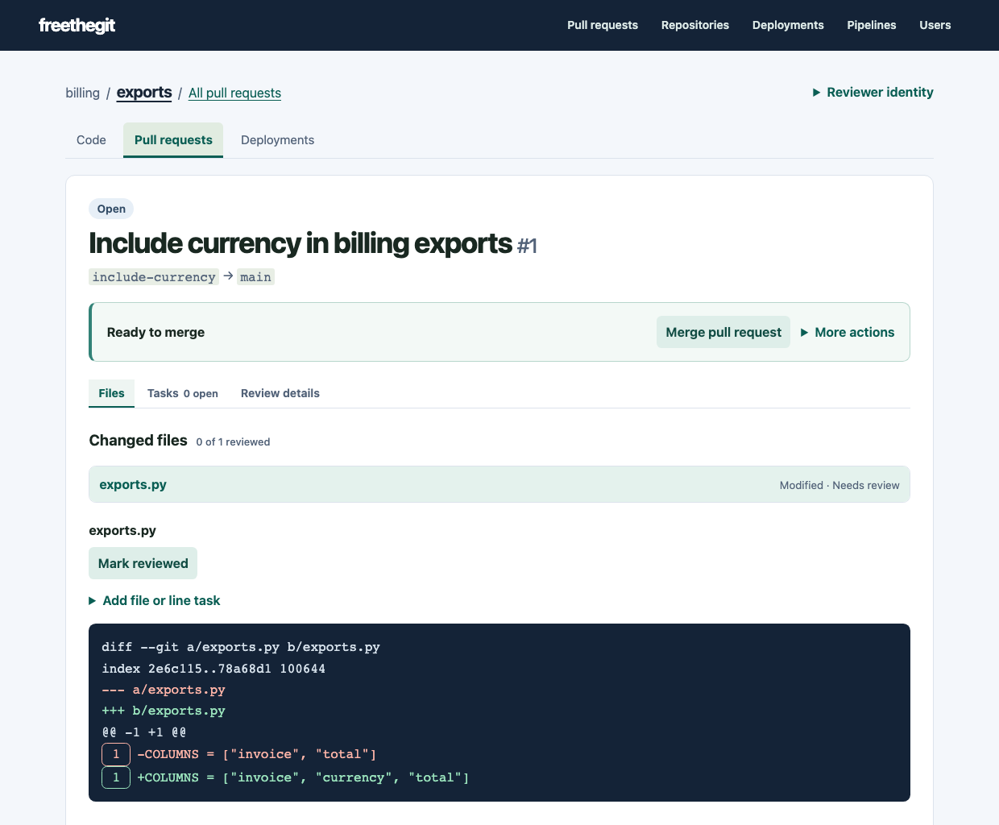

# FreeTheGit

FreeTheGit is a local Git host for people who review code alongside agents. A review task can point to a line in a file that has since been renamed. Open it and you still see the code the reviewer meant.



[Quickstart](#quickstart) · [Review a change](#review-a-change) · [Publish a snapshot](#publish-a-snapshot) · [Local accounts and storage](#local-accounts-and-storage) · [Development](#development)

## Quickstart

You need **Python 3.10+**, **Git 2.38+** on your PATH, and a browser. FreeTheGit uses the Python standard library and SQLite.

```sh
git clone https://github.com/mmsa/freethegit.git
cd freethegit
python3 web.py
```

Open the local workspace and choose **Create example review** at the foot of the **Pull requests** page. It creates a real Git repository with two branches and a small change to a billing export. To start your own project, choose **Repositories → New repository**. On its Code page, describe what you want to build and select **Create README.md** to make the first Git commit from the browser. If you already have a local project, expand **Push an existing Git project** and run the command from your project directory. [Open FreeTheGit](http://127.0.0.1:8091/)

## Review a change

1. **Read the diff.** Open a pull request and choose a changed file. Click a line number to add a task to the before or after version. Whole-file tasks work for binary files too.
2. **Review a later push.** Choose **Open fresh review**. Unresolved tasks carry forward with links to their original code. Unchanged files keep their shared review marks. Personal sign-offs stay with the commits each person saw.
3. **Merge the reviewed commits.** Resolve the open tasks and select **Merge pull request**. FreeTheGit rechecks both branch tips and reports stale revisions or conflicts before changing the target branch.

**Review with an assistant.** Choose **Copy review brief** on a pull request and paste it into an assistant with access to the FreeTheGit checkout. The brief specifies the reviewed commits, the full change to inspect, and where to find open tasks. To inspect it yourself, expand **Review brief and Git commands**. The commands read the saved objects directly from the hosted repository, so a later push does not change the comparison.

**Attach the results.** In **Review details → Attach an agent report**, copy the command generated for that PR. It records the agent's findings, test results, run ID, and reviewed commit. Add `--work-item` and `--work-url` to link a requirement in a local WeftTrack workspace. Reviewers can see when a report refers to an earlier revision.

## Publish a snapshot

In a hosted repository, open **Deployments**, choose the branch and environment, then **Load revision → Publish snapshot**. Every published revision has a downloadable ZIP. If it contains a prebuilt `index.html` in the root, `dist/`, `build/`, `public/`, or `docs/`, **Open site** opens a sandboxed local preview. Revision links stay pinned. The environment link follows the latest publication.

Static previews support relative links to packaged HTML, CSS, images, and fonts. Scripts, form submissions, and external assets are disabled in previews. Build execution, application servers, and remote deployment require a separate runner.

## Local accounts and storage

The server binds to `127.0.0.1:8091` for use on a trusted machine. Open **Users** to create the first owner and add reviewer accounts. Once configured, password-backed sessions identify authors and reviewers. Deactivating an account revokes its sessions and preserves its review history. Git pushes, general review tasks, and merges remain available to local clients without signing in.

Bare repositories, SQLite records, accounts, and published archives live under `.repositories/` in the checkout. The pipeline editor stores its project and stage configuration in the browser. Back up the server directory and retain the browser profile if you need both.

## Development

Run the full regression suite from the repository root. Tests create disposable Git repositories and databases.

```sh
python3 -m unittest discover -v
```

The bundled field guide follows a team shipping scheduled CSV exports. Read it in the browser, use the Markdown guides directly, or run `python3 fieldguide.py list` to see chapter IDs. The CLI also supports `show`, `search`, `related`, and `graph`. [Browser field guide](http://127.0.0.1:8091/guide) · [Repository hosting](guides/repo-host.md) · [Work tracking](guides/work-tracker.md)

Code and documentation are released under the [MIT license](LICENSE).
