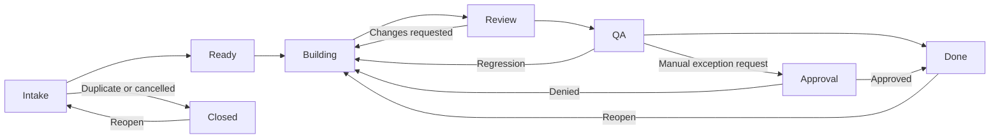

# Work Tracker field guide

Examples use generic names and placeholder hosts. Product-specific plans, dates, and settings are historical reference details and may differ from your deployment. Walkthroughs use Work Tracker Cloud unless marked Data Center. UI labels and feature availability depend on the space template, plan, permissions, and rollout. All BILL records are fictional, and URL and credential examples use placeholders.

<!-- work-tracker-overview -->
## 1. What Work Tracker does

Work Tracker gives a team a shared record of what it intends to deliver, who owns it, where it stands, and what changed. Vendor unified **Work Tracker Software** and **Work Tracker Work Management** into **Work Tracker** in Cloud. Cloud uses **space** for what older articles call a **project**, and **work item** for **issue**. Data Center release notes still say **Work Tracker Software Data Center**, and older labels remain in many Data Center installations, JQL aliases, API paths and integrations. An Vendor Project used to communicate an initiative's progress is a separate object from a Work Tracker space.

| Person | Everyday work in the Billing example |
|---|---|
| Product manager | Turns requests for scheduled export into an epic, writes acceptance criteria, orders the backlog, and checks dependencies. |
| Developer | Pulls BILL-42 into a sprint, opens a Repository Host PR, and updates status when the change is ready for review. |
| Team lead | Watches the board for blocked work, replans sprint capacity, and verifies the release scope. |
| Business user | Tests the export, coordinates customer communications, and follows the launch checklist in a business space. |
| Administrator | Grants access, governs shared configuration, tests automation, and monitors audit activity. |

Work Tracker Service Management handles portal requests, queues, SLAs, and service operations. Work Tracker Product Discovery captures and prioritizes ideas, then links them to Work Tracker delivery work. Both have separate product entitlements. Confluence stores durable design and release material. Repository Host stores code and shows the changes behind each work item. Teamwork Collection bundles Work Tracker, Confluence, Loom, and Rovo. Software, Service and Strategy Collections have their own product and plan packaging. Check the specific subscription before assuming access follows a Work Tracker license.

<!-- work-tracker-structure -->
## 2. Structure and example records

An **organization** manages identities, policies and subscriptions across Vendor apps. A **site**, typically on an `vendor.net` domain, contains app instances. A Work Tracker **space** organizes work and configures available **work types**. A **board** presents a view of qualifying work and can span spaces when a company-managed board filter does. Data Center uses self-managed instances and projects. Its identity, user management and deployment model differs from Cloud.

| Key | Work type | Parent | Work |
|---|---|---|---|
| BILL-40 | Epic | — | Launch scheduled billing exports |
| BILL-42 | Story | BILL-40 | As a billing admin, receive a scheduled CSV export |
| BILL-43 | Task | BILL-40 | Publish the export runbook |
| BILL-44 | Bug | BILL-40 | Correct daylight-saving schedule drift |
| BILL-45 | Subtask | BILL-42 | Write a regression test for timezone conversion |

An epic groups work. Stories, tasks, and bugs normally occupy the same standard hierarchy level. A subtask belongs to a standard-level parent. A link such as “BILL-44 blocks BILL-42” adds a dependency without changing either parent. Premium and Enterprise advanced planning support additional hierarchy configuration for eligible company-managed work. A work item key combines the space key and a sequence, and can change on movement. An internal ID is useful for API lookups within the same instance. Track source and target IDs explicitly during migration.

For BILL-42, use component Reporting where components are configured, labels `csv-export` and `customer-facing`, priority High, an engineer as assignee, and fix version `1.4.0`. Components group work within a space and can have owners or default assignment in supported configuration. Labels are lightweight tags. Affects Version records where a bug occurs. Fix Version records the intended delivery and makes it visible in Releases where enabled. Watchers subscribe to eligible events. Comments coordinate work, attachments hold artifacts such as sanitized QA output, and Activity shows changes to fields and state.

| Cloud configuration | Team-managed | Company-managed |
|---|---|---|
| Ownership | Space admins manage local configuration | Work Tracker admins manage shared schemes and workflows. Space admins operate within delegated controls |
| Reuse | Local fields, types and workflows favor autonomy | Shared workflows, screens and schemes favor consistency |
| Board | Space-based experience and available features depend on template | Filter-backed boards can span spaces. Single-space boards may have the newer board UI |
| Migration | Create a destination space and move mapped work items | Recreate compatible types, fields, statuses and schemes before the move |

Pilot a move before touching production. Vendor documents differences in story-point fields, report history, local custom fields, and versions. Preserve links, export values you need, map field IDs and verify translated board JQL and permissions.

<!-- work-tracker-daily -->
## 3. Day-to-day work

1. Pick a software Scrum template for Billing and create BILL-40. Use **Create** and choose Billing and Story to enter BILL-42. Add the parent, acceptance criteria, and QA notes. Use company-managed field configuration if the field you need is unavailable.
2. Edit the description as requirements change. Assign it to an eligible engineer. Comment with an @mention when you need a specific person to act. Watch the item to follow events your notification settings and permissions allow.
3. Add BILL-44 through the link action and choose **is blocked by** on BILL-42. Create BILL-45 as a subtask. Open the Confluence design from the description and confirm teammates have permission to the linked page.
4. To move an item, choose the destination space and work type from **More actions → Move**, then map statuses and fill required fields. To clone an item, choose **Clone**, check which optional relationships and attachments the dialog copies, and review the new key and fields. Keep the original for its history.
5. In search, save the exact filter and preview its results. Use bulk change only after reviewing the selected results, upcoming changes, permissions and notifications. Start with two records before changing a large batch.

Use a backlog for ordering, board for flow, list for scanning fields, and dashboard for multiple filter-driven views. Which views exist depends on template and configuration. Saving a filter preserves a query. Sharing its definition or a dashboard does not provide access to the underlying work. Without browse access an item can disappear from search or appear inaccessible at its URL. Without a specific action permission the UI can hide the action or reject it. Move also requires create permission in the destination. Bulk change requires the global bulk permission and relevant item permissions.

<!-- work-tracker-workflow -->
## 4. Workflows and configuration

A **status** is a work item's state, grouped under To Do, In Progress or Done. A **transition** is an allowed move and may include conditions, validators and actions (called post functions in older editors). A **resolution** records the outcome, such as Fixed or Won't Do. In company-managed workflows a Done status can coexist with empty Resolution. Set Resolution on every appropriate terminal transition and clear it when reopening. Work Tracker sets the resolved date when Resolution changes from empty to a value, which matters to resolution-based reports. Team-managed workflows use their own status and rules model.



1. List statuses and explicit transitions. For Billing use QA for verification, Approval for exceptions, and distinguish a completed export from cancelled work.
2. In a company-managed test space, create or copy a workflow. Limit exception approval to the authorized role. Require evidence on the Done transition with a rule or validator supported in the editor. Premium/Enterprise advertise customizable approval features. A manually restricted approval transition is a way to represent signoff when an approval feature is unavailable.
3. Add rules to set Fixed or an appropriate alternate resolution at terminal transitions. Add the clear action to reopen transitions. Verify ordinary and exception paths as a developer and a reviewer.
4. Map each work type to its workflow through a workflow scheme. Publish the draft or activate the replacement, map existing statuses when prompted, then confirm board columns, filters and automation rules. A single edit to a shared workflow or scheme can affect several spaces. Check associations and test a copied configuration before rollout.

A **screen** selects fields available during Create, Edit, View or a transition where supported. A **layout** decides where an available field appears in the work item view. A **field configuration** controls behavior such as requiredness and visibility in applicable company-managed configurations. A **custom field context** controls affected spaces or types and can set options/defaults. Schemes associate configuration with spaces and work types. When a field disappears, check its context, operation screen, layout, hidden state and app permission before creating a duplicate field.

<!-- work-tracker-planning -->
## 5. Scrum, Kanban, planning, and reporting

**Scrum.** Rank work in the backlog, refine BILL-42 and BILL-44, estimate with the board's configured statistic, set a sprint goal and start a sprint. Assign BILL-42 and BILL-44 to the sprint. The team builds, reviews, and tests them. When completing the sprint, check what moves back to the backlog or next sprint. In company-managed boards, the rightmost column determines completion for sprint reports, so map Done statuses deliberately. **Kanban.** Replenish a ready queue continuously, pull new work as capacity permits, and use a WIP limit to flag overloaded columns. A quick filter further narrows the view, and swimlanes group cards by criteria. Inspect saved filter scope and access when cards are missing. Ranking typically uses `ORDER BY Rank ASC` for company-managed board filters that support manual prioritization.

Use a space timeline for local sequencing where enabled. Cloud Premium and Enterprise **Plans** add cross-team sources, dependencies, and capacity planning where the plan's teams, estimation and work sources support it. Link BILL-44 as a dependency, assign fix version 1.4.0, and attach the runbook to the release. After the validated Repository Host build deploys, check unresolved work and release the version. Releasing a Work Tracker version records a planning milestone and does not itself deploy code.

| Report | How to read it | What can skew it |
|---|---|---|
| Burndown | Remaining board estimate or work count over the sprint. Compare the remaining line with elapsed time and inspect changes in scope. | Mid-sprint adds/removals or re-estimation. Work mapped outside the rightmost column can stay incomplete. |
| Velocity | Compare at-start commitment against completed work across closed sprints in the selected statistic. Use several comparable sprints for forecasting. | Mapping changes, late-added work, changes to estimation scale or team size. Avoid comparing points across teams. |
| Cumulative flow | Each band counts items in a mapped board column over time. Widening QA suggests arrivals outpace completions. | Filter changes, unmapped statuses, historic transitions and columns that group dissimilar stages. |
| Control Chart | Each dot shows time spent in selected mapped columns. Select active columns for cycle time and inspect outliers and spread. | Including backlog or waiting statuses, reopening, atypical work, and narrow time windows. |
| Created vs. resolved | Counts creation dates and resolution dates over a period. Compare the two series to assess backlog growth. | Done items without resolution, stale resolutions on reopened items, and changing filter scope. |

Report availability depends on board or space type. Vendor documents a different team-managed report set. Check whether a particular report scopes to the board or the whole space before comparing a dashboard with a report.

<!-- work-tracker-search -->
## 6. Search, reporting, and JQL

Use basic search for guided field selectors and switch to JQL when you need functions, history, or nested conditions. Save a filter, define its viewers and editors, and use it in gadgets such as Filter Results or Two-Dimensional Filter Statistics. A subscription emails results on a schedule under applicable permissions. CSV exports use the results and columns you choose, subject to export and instance limits. Use API pagination for repeatable high-volume extraction. Keep restricted data out of shared exports. Many fields still accept longstanding `project`, `issuetype`, and `issue` vocabulary. Start with autocomplete if your site offers newer aliases.

All examples use native Work Tracker Cloud JQL, require Browse access to matching items, and assume the fictional Billing space exists. Names, values and field availability can vary. ScriptRunner and other apps add functions of their own, which require those installed apps and may not run on another deployment.

| JQL | Result, syntax, and prerequisites |
|---|---|
| `key = BILL-42` | Exact human-readable key. Requires that record or its recognized key. |
| `project = BILL ORDER BY created DESC` | Billing items, newest first. The older field name `project` accepts the space key. |
| `project = BILL AND issuetype IN (Story, Bug)` | Stories and bugs. Both work type names must exist. `IN` compares against a list. |
| `project = BILL AND assignee = currentUser() AND statusCategory != Done` | My unfinished Billing work. Sign in for the identity function. |
| `project = BILL AND assignee IS EMPTY ORDER BY priority DESC, created ASC` | Unassigned work, sorted by priority then oldest first. Empty is tested with `IS`. Priority order follows the configured scheme. |
| `project = BILL AND created >= startOfWeek() ORDER BY updated DESC` | Work created since the configured week began, sorted by most recent activity. Check timezone and week-start settings. |
| `project = BILL AND updated >= "2026-11-01" AND updated < "2026-12-01"` | Work whose last update was in November. Half-open boundaries avoid midnight overlap. Dates use the applicable timezone. |
| `project = BILL AND (labels NOT IN ("csv-export") OR labels IS EMPTY)` | Includes items without the label and items with no labels. The explicit empty branch handles nulls. |
| `parent = BILL-40 ORDER BY Rank ASC` | Immediate children of the epic, ranked. It does not recursively include the story's subtask. Requires the parent and a usable Rank field. |
| `project = BILL AND fixVersion = "1.4.0" AND resolution IS EMPTY` | Unresolved work targeted for 1.4.0. Create the version and set Fix Version on work. Interpret Resolution with the workflow. |
| `project = BILL AND sprint IN openSprints() AND statusCategory = "In Progress"` | Work in active sprints and the in-progress category. Requires a sprint-enabled space and active sprint data. |
| `project = BILL AND status CHANGED TO "QA" AFTER "-7d"` | Items whose status entered QA during the last seven days. Requires that status and relevant history. |
| `project = BILL AND statusCategory = Done AND resolution IS EMPTY` | Finds potential company-managed workflow mismatches. Confirm whether empty Resolution is unintended. |
| `project = BILL AND (priority = High OR (issuetype = Bug AND labels = "csv-export")) AND statusCategory != Done ORDER BY priority DESC, updated DESC` | Open high-priority work or open CSV-export bugs. Parentheses apply the open condition to both branches. Requires the named priority, work type and label values. |

<!-- work-tracker-automation -->
## 7. Automation and integrations

An automation flow starts with a trigger, evaluates conditions, and runs actions. A branch changes the evaluation context to related work. Smart values such as `{{issue.key}}` and `{{version.name}}` draw from the event. Work Tracker retains older names in smart-value syntax. Scope the flow to the smallest set of spaces. The actor needs permissions and workflow access where it reads or writes, including in target spaces.

1. **Triage:** On work item created, check Billing and Bug, then label it `needs-triage` and assign to a designated eligible triager if the assignee is empty. Test a Story and Bug to verify both paths.
2. **Related updates:** On transition of BILL-44 to Done, branch to linked blocked work, constrain it to Billing, and comment that `{{triggerIssue.key}}` was resolved. Don't clear a blocked state automatically if there may be other dependencies. Re-fetch data if a later action depends on values just changed.
3. **Release notice:** On version released, look up work in that version and count unresolved items. If none remain, send the configured channel a link to release notes, version name and work summary. Otherwise inform the release owner. This trigger confirms the Work Tracker milestone. The deploy step still belongs to CI/CD. Test with a separate version and channel.

If a flow fails, inspect the audit log for the trigger, condition output and first failed action. Check actor permissions, field context, transition and connector credentials. Guard against loops by checking whether the target field actually needs a change, keeping automation-triggered execution off where practical, and avoiding reciprocal updates. Service limits apply to individual executions and fan-out. As of verification, Vendor also documents the earlier monthly run limits and announces usage-based billing beginning December 3, 2026. The new model meters executed steps, pools allowances at organization level, and excludes certain system, aborted and no-action runs. Check the admin usage screen for the model and allowance applicable to your subscription.

| Tool | Connection |
|---|---|
| Confluence | Vendor product integration. Link design or runbook pages and embed Work Tracker views where supported. Page and Work Tracker access remain independent. |
| Repository Host Cloud | Connect a workspace with admin consent. Include work keys in branch names, commits and PRs for development visibility. |
| GitHub Cloud | Optional GitHub for Vendor app. Needs site admin and GitHub organization-owner involvement. |
| Slack | Optional Work Tracker Cloud connector/app. Authorize the workspace, then control channels and event subscriptions. |
| Microsoft Teams | Optional Work Tracker Cloud for Teams app installed from the Teams app store. Add it to the channel and sign in. |
| Other tools | Use an official connector or evaluate a Marketplace app. For bespoke systems, use scoped API access or webhooks. Feature and permission parity depend on deployment and connector. |


<!-- work-tracker-governance -->
## 8. Administration, security, and governance

Product access lets a signed-in user use Work Tracker. Groups can grant product access and populate space roles. A permission scheme grants actions to groups, roles, or other principals in company-managed spaces. Work-item security can further restrict individual records. Team-managed spaces use their own access and role settings. Filter and dashboard sharing govern the views, while notification schemes, watchers, event delivery, and personal preferences govern alerts. Check each layer with the affected person's identity.

| Example principal | Grants in the Billing example | Effective result |
|---|---|---|
| Engineer | Work Tracker access, Billing developer role, Browse, Edit and Transition | Can see and update regular items. Can't see a security-level item unless included at that level. |
| QA reviewer | Work Tracker access, Browse, comment and transition grants, approved role for QA gate | Can test, comment and close when the gate's conditions pass. |
| Executive | Shared dashboard, Browse to Billing, no edit grant | Reads accessible results and cannot edit the items. |
| External reviewer | Approved product/space access and narrowly scoped browse/comment access | Reads permitted work. A link or mention alone gives no new access. |
| Automation actor | Work Tracker access and explicit roles in source and target | Can complete only actions permitted by target fields, transitions and security. |

For missing BILL-42, confirm correct site and account, product access, Browse grant, work item security, and filter criteria. For edit or transition problems, check the specific action permission and workflow rule. Use Work Tracker's permission helper where available to test the user, item and permission. Check public and anonymous grants when auditing external access. Work Tracker Service Management portal customers have their own separate access model.

Cloud paid Work Tracker plans list data residency for eligible in-scope data. Verify linked apps and separate Marketplace app coverage. Vendor Guard Standard provides identity controls such as SAML SSO and SCIM where applicable, is included in Work Tracker Cloud Enterprise, and can be a separate subscription on other plans. Align organization audit, Work Tracker configuration audit and automation audit with their retention and event coverage. Plan backup frequency, retention, RPO and RTO. Site export, CSV and Vendor Backup and Restore have different coverage and restore workflows. Verify restore of attachments, app data and identity mappings. For Data Center, protect the database, home/shared home, app data and secrets and rehearse a consistent restore on an isolated instance.

<!-- work-tracker-platform -->
## 9. Extensibility, deployment, and migration

Cloud is Vendor-operated and receives rolling changes. Data Center gives your organization control over infrastructure and upgrade timing. Use plan and release documentation for the actual environment, especially with Marketplace apps. Vendor ended new Work Tracker Data Center license sales to new customers on March 30, 2026 and lists March 28, 2029 as end of life. Its published transition timeline names March 30, 2028 for the end of eligible existing customer purchases of new Data Center licenses, apps and expansions. Server support ended February 15, 2024. Work Tracker Software Data Center's release index identifies 11.3 and 10.3 as current LTS lines at verification. Repository Host follows a distinct Hybrid path.

Use Forge for new Work Tracker Cloud Marketplace app development. Vendor extended Work Tracker and Confluence Connect end of support to January 31, 2027. Inventory any Connect apps and get each vendor's migration dates and data plan. For Data Center, use app and plugin APIs supported by the target release, and test app compatibility before upgrades. For external Cloud integrations, use OAuth 2.0 authorization code grants for delegated access or API tokens for limited scripts, ideally assigned to a narrowly authorized service account for unattended jobs where available. REST user-password and cookie-based authentication were deprecated in 2019.

This Work Tracker Cloud command reads the summary, status and fix versions for a release readiness check. Use a scoped token with read permission, the corresponding service or user email, the correct cloud ID, and access to BILL-42. Set the environment values through your secret store before invoking it.

```sh
curl --fail-with-body --silent --show-error \
  --user "${Work Tracker_ACCOUNT_EMAIL}:${Work Tracker_API_TOKEN}" \
  --header 'Accept: application/json' \
  'https://api.example.invalid/ex/work-tracker/<cloudId>/rest/api/3/issue/BILL-42?fields=summary,status,fixVersions'
```

Cloud REST v3 keeps the `issue` path. Data Center uses instance-specific paths such as `/rest/api/2/issue/{key}` and supports version-specific authentication including personal access tokens where enabled. Follow endpoint pagination metadata: some endpoints use offsets and others use continuation tokens. Request only necessary fields, handle 429 and Retry-After with backoff, and avoid automatic duplicate writes. Register webhooks for event-driven updates where supported, authenticate the receiver according to the selected webhook type, enqueue events, deduplicate deliveries and reconcile periodically. Vendor's app rate limits include burst and quota constraints. Token traffic has its own applicable constraints.

For Data Center to Cloud, inventory spaces/projects, groups/users, duplicate field names, statuses, workflows, permissions, links, automation actors, and Marketplace data. Check Vendor migration assistant and app vendor support. Use a test migration, map IDs and identities, validate a sample across work types and permission levels, and reconcile attachment counts, filters, boards, links, and release history. Schedule cutover and define when to halt or revert. Disable duplicate outbound automations before opening the destination.

<!-- work-tracker-adoption -->
## 10. Plans, limits, and adoption

Cloud plan comparison verified **November 24, 2026**. US price examples below are displayed illustrations for monthly billing. Check the live calculator for seat count, billing interval and currency. The automation column shows the published step allowances for the usage-based model starting December 3, 2026.

| Cloud plan | Displayed pricing | Storage | Automation step allowance | Selected capabilities |
|---|---|---|---|---|
| Free | $0, up to 10 users | 2 GB | 150 per subscription per month | Boards, backlog, community support |
| Standard | $7.91 per user per month | 250 GB | 400 per user per month | Configurable permissions, eligible data residency and paid support |
| Premium | $14.54 per user per month | Unlimited | 750 per user per month | Cross-team Plans, approval features, 99.9% SLA |
| Enterprise | Annual quote | Unlimited | 1,000 per user per month | Multiple sites (up to 150), Analytics and Data Lake, Guard Standard, 99.95% SLA |

Older plan tables cite run limits of 100/month on Free, 1,700/month on Standard, 1,000/month per paid user on Premium and unlimited on Enterprise. Counts from these tables describe runs, while the new model meters steps. Cloud seats follow subscription and billing rules. Enterprise can manage eligible users across multiple sites centrally. Marketplace apps, Guard and neighboring products may have their own entitlements. Data Center uses its own user-tier subscription licensing and lifecycle.

A small team can start with one space and a simple workflow, then add fields when decisions require them. For a large organization, share stable workflows and roles, document who owns each scheme, and keep an exception process and test site where supported. Use reusable standards for status mapping and measure the results of changes before scaling. Teach users how to file work, prioritize it, track blocked items and find their dashboard. Design dashboards around questions such as “What could block 1.4.0?” rather than mirroring all available fields.

<!-- work-tracker-reference -->
## 11. Glossary, setup checklist, and troubleshooting

| Term | Meaning |
|---|---|
| Space / project | Work Tracker Cloud container for work. Older references and Data Center commonly say project. |
| Work item / issue | A trackable record. APIs and older references can use issue. |
| Work type / issue type | Classification such as Bug, Story or Epic. |
| Scheme | Reusable mapping between configuration and spaces or work types. |
| Status / resolution | Current state and closure outcome respectively. |
| Board / filter | Visual view and saved query that can feed that view. |
| Sprint / version | Timeboxed work cycle and release milestone respectively. |
| Automation actor | Account whose permissions govern rule actions. |

**Setup checklist**

1. Confirm the subscription, site, security owner and space owners.
2. Create Billing from a software template and choose team-managed or company-managed configuration.
3. Map groups and roles, test a read-only user and a contributor, and verify any restricted work.
4. Create BILL-40 and its children, assign BILL-42, link BILL-44, and add fix version 1.4.0.
5. Configure the board, estimates, columns, approval and reopen paths. Verify resolutions on test items.
6. Connect code and design, run a test automation, review its audit log, and create a saved release-readiness filter.
7. Validate QA, deploy from Repository Host or your CI runner, release the Work Tracker version, and review sprint and flow metrics.

| Symptom | Inspect first |
|---|---|
| Work item missing | Site/account, space browse, work item security, then filter criteria and recent move. |
| Broken board | Filter ownership and sharing, JQL, status/column mapping, quick filters, backlog and ranking. |
| Done work counted unresolved | Resolution field, terminal and reopening rules, and whether the report uses rightmost column or Resolution. |
| Missing or noisy emails | Watcher/mention, recipient access, event subscription, user preference, notification scheme and mail delivery. |
| Automation failed or looping | Audit entry, actor scope and permissions, triggering value and re-entry guards, service and subscription limits. |
| Development activity missing | Connection authorization, repo visibility, key in branch/commit/PR, sync health and permissions. |
